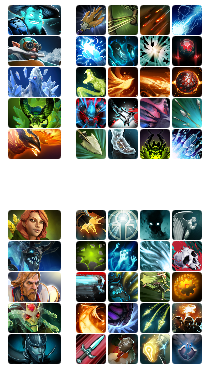
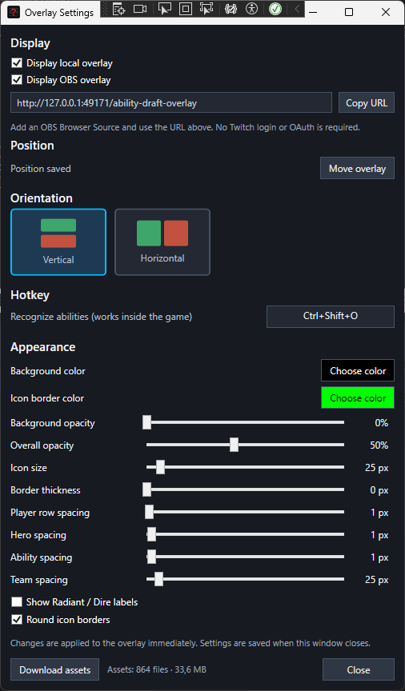

# Ability Draft Overlay

Overlay for Dota 2 Ability Draft mode: recognizes picked heroes/abilities and shows them over the game

<table width="100%">
  <tr>
    <th width="50%" align="center">Overlay</th>
    <th width="50%" align="center">Settings</th>
  </tr>
  <tr>
    <td width="50%">
      
    </td>
    <td width="50%">
      
    </td>
  </tr>
</table>

## How it works

1. Download the icon resources (Overlay settings → **Download assets**).
2. At the end of the draft press **Recognize** (or `Ctrl+Shift+O`).
3. Move the overlay and adjust spacing, border, etc.

> **Note:** put the exe into its own folder (e.g. `D:\Games\AbilityDraftOverlay`), not the Desktop. `Assets`, settings and `app.log` are created next to it.

## Requirements

- Windows 10/11
- [.NET 10 Desktop Runtime](https://dotnet.microsoft.com/download/dotnet/10.0) (x64).
- 1920x1080 screen resolution.
- Dota 2 in **Borderless Window** or **Windowed** mode, game language English.
- Windows text recognition for **English** used to read hero names. It is usually already there if English is among your Windows languages.

## External resources

- [OpenDota constants](https://github.com/odota/dotaconstants)
- [Steam CDN images](https://cdn.cloudflare.steamstatic.com/apps/dota2/images/)

## OBS Browser Source overlay

The application can publish the current Ability Draft board to OBS without capturing the WPF overlay window. Open **Overlay Settings** and enable **Display OBS overlay**. Copy the generated local URL and add it in OBS as a **Browser Source**. Set the source dimensions to your stream canvas (for example, 1920 × 1080). The page has a transparent background and receives live updates from the application.

The OBS endpoint is served by the .NET runtime itself (`HttpListener` + WebSocket); Node.js, ASP.NET Core hosting, Twitch login and Twitch OAuth are not required. The server listens only on `127.0.0.1` and starts only while the OBS option is enabled. The generated URL contains a random access token; keep it private and regenerate it by clearing `ObsAccessToken` from `overlay-settings.json` while the application is closed.

Hero and ability images are served from the existing local `Assets` directory using the same fallback order as the WPF overlay. No image files are copied to OBS or uploaded to Twitch by the application.
