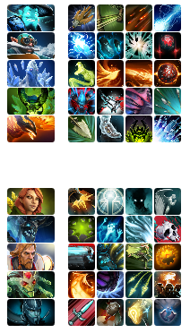
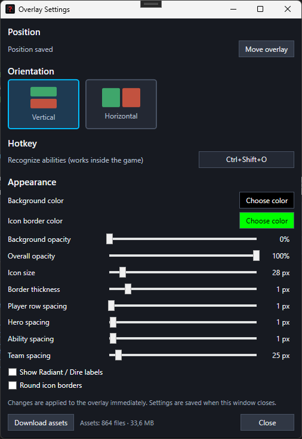

# Ability Draft Overlay

Windows overlay for Dota 2 Ability Draft: recognizes the heroes and abilities of all 10 players from a screenshot and shows them over the game.

<table width="100%">
  <tr>
    <th width="33.33%" align="center">Overlay</th>
    <th width="33.33%" align="center">Settings</th>
    <th width="33.33%" align="center">In game</th>
  </tr>
  <tr>
    <td width="33.33%">
      
    </td>
    <td width="33.33%">
      
    </td>
    <td width="33.33%">
      
    </td>
  </tr>
</table>

## How it works

1. Download the icon resources (Overlay settings → **Download assets**).
2. At the end of the draft press **Recognize** (or `Ctrl+Shift+O`).
3. Move the overlay and adjust the spacing if needed.

## Requirements

- Windows 10 (build 19041) or newer, 64-bit.
- [.NET 10 Desktop Runtime](https://dotnet.microsoft.com/download/dotnet/10.0) (x64).
- 1920x1080 screen resolution.
- Dota 2 in **Borderless Window** or **Windowed** mode, game language English.
- Windows OCR language **English (United States)** installed.

## External resources

- [OpenDota constants](https://github.com/odota/dotaconstants)
- [Steam CDN images](https://cdn.cloudflare.steamstatic.com/apps/dota2/images/)
